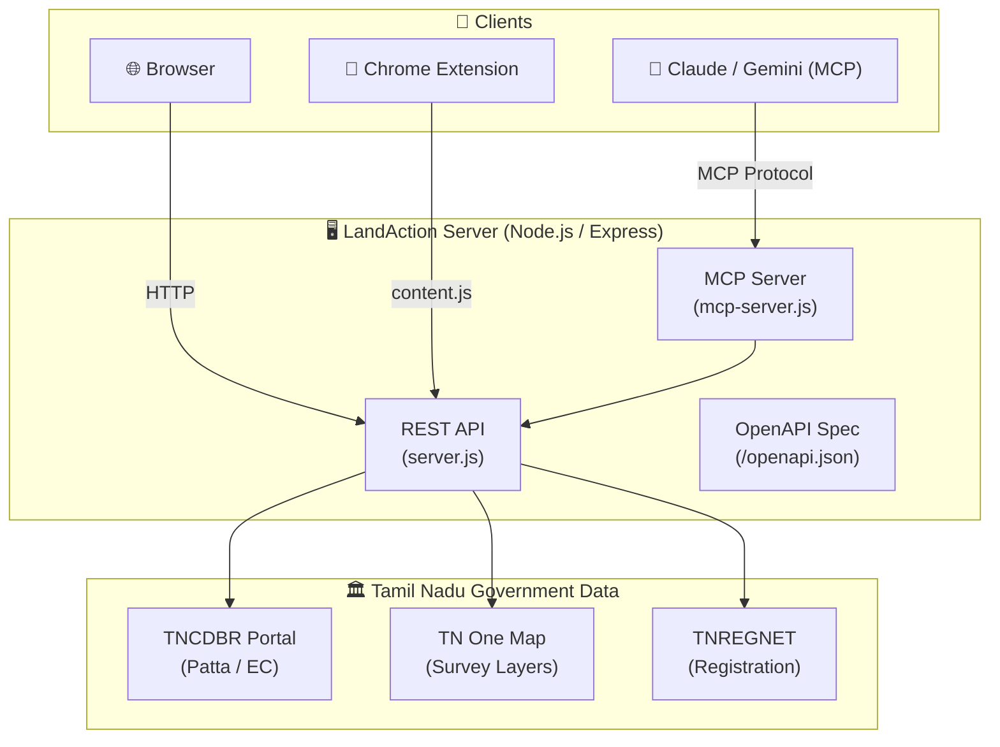

<div align="center">

# 🗺️ LandAction

**Open Land Intelligence Platform for Tamil Nadu**

[](https://github.com/harinish45/land-action/actions/workflows/ci.yml)
[](LICENSE)
[](https://nodejs.org)
[](https://spec.modelcontextprotocol.io)

> *Free replica of LandLens — Patta, Encumbrance Certificate, and Survey data for Tamil Nadu via MCP*

[📋 TODO & Roadmap](TODO.md) · [🔌 API Docs](public/openapi.json) · [🚀 Deploy on Render](render.yaml)

</div>

---

## ⚡ Features

| Feature | Status |
|---------|--------|
| 🗺️ OneMap Tamil Nadu Integration | ✅ |
| 🏠 Patta (Chitta) Data Lookup | 🔧 |
| 📜 Encumbrance Certificate Fetch | 🔧 |
| 🔍 Survey Number → Owner Mapping | 🔧 |
| 🤖 MCP Server (Claude/Gemini) | 🔧 |
| 🌐 Chrome Extension | 🔧 |

---

## 🏗️ Architecture



---

## 🚀 Quick Start

```bash
# Clone
git clone https://github.com/harinish45/land-action.git
cd land-action

# Install
npm install

# Run server
npm start          # → http://localhost:3000

# Run MCP server
npm run mcp        # MCP-compatible AI tools

# Run tests
npm test
```

---

## 📁 Project Structure

```
land-action/
├── 🖥️  server.js              # Express REST API
├── 🤖  mcp-server.js         # Model Context Protocol server
├── 📂  api/                  # API route handlers
├── 🌐  public/
│   ├── index.html            # Main UI
│   ├── openapi.json          # OpenAPI 3.0 spec
│   └── js/
│       ├── app.js            # Frontend logic
│       └── onemap.js         # OneMap TN integration
├── 🔌  chrome-extension/     # Browser extension
├── 📚  docs/                 # Documentation
├── 🧪  test/                 # Smoke tests
└── ⚙️  vercel.json / render.yaml
```

---

## 🌐 Deployment

| Platform | Config | Status |
|----------|--------|--------|
| Vercel | `vercel.json` | Ready |
| Render | `render.yaml` | Ready |

---

## 📋 Roadmap

See [TODO.md](TODO.md) for the full 4-phase roadmap including MCP tool definitions, Chrome Extension UI, and production deployment.

---

## 📎 Data Sources

- [TNCDBR Portal](https://www.tncdbr.tn.gov.in) — Patta & EC data
- [TN One Map](https://www.tnmap.tn.gov.in) — Survey layers
- [MCP Specification](https://spec.modelcontextprotocol.io) — Protocol reference

---

<div align="center">
Made with ❤️ for Tamil Nadu land transparency · <a href="LICENSE">MIT License</a>
</div>