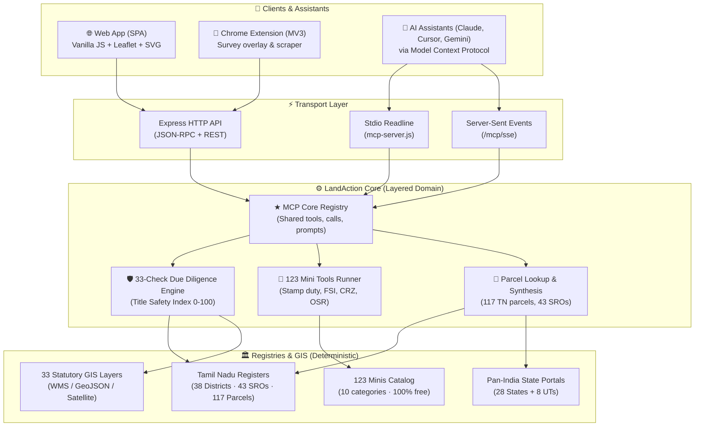

<div align="center">

# 🗺️ LandAction

**Autonomous Cadastral Intelligence, Land Due Diligence & Title Verification Platform**

[](https://github.com/harinish45/land-action/actions/workflows/ci.yml)
[](LICENSE)
[](https://nodejs.org)
[](https://spec.modelcontextprotocol.io)
[](public/data/tn_registers.json)
[](test/smoke.mjs)

> *100% Free · Zero Credit Paywalls · 9 Integrated Products · MCP Server Active · 33-Point Statutory Screening*

[📋 Roadmap & TODO](TODO.md) · [📊 Teardown Spec](docs/landlens-teardown.md) · [🔌 OpenAPI Spec](public/openapi.json) · [🚀 Deploy on Render](render.yaml)

</div>

---

## 📖 Overview

**LandAction** is an open, autonomous land intelligence and due diligence platform for India. It provides a complete, 100% free alternative to commercial land platforms (such as LandLens), delivering comprehensive spatial screening across 33 statutory risk layers, 123 micro-tools, 25-year registered price trends, TNCDBR 2019 building feasibility, 50-year title lineage tracing, and an active **Model Context Protocol (MCP)** server for AI assistants (Claude, Cursor, Windsurf, ChatGPT).

---

## 🏗️ Architecture



---

## 🧩 Codebase Structure

The codebase is strictly layered so domain logic never depends on transport:

```
server.js                 entry: createApp() + listen() + graceful shutdown
mcp-server.js             entry: stdio transport (thin readline wrapper)
api/index.js              Vercel serverless entry (re-exports app)
src/
├── config.js             ports, paths, server info (single source of truth)
├── app.js                wiring: middleware order, routers, SPA fallback
├── data/registry.js      JSON registers loaded once, cached and shared
├── domain/parcels.js     parcel lookup + realistic TN parcel synthesis
├── services/
│   ├── tool-runner.js    the core mini-tools (pure functions)
│   ├── verify-report.js  33-check due diligence report builder
│   └── chat.js           Veritas legal assistant keyword responder
├── mcp/mcp-core.js       ★ THE MCP implementation: tools/list, tools/call, prompts/list
└── http/
    ├── middleware.js     security headers, access log, JSON 404, error handler
    ├── routes-api.js     /api/v1/* REST routes
    └── routes-mcp.js     POST /mcp + GET /mcp/sse (host-aware endpoint)

scripts/
├── generate-minis.mjs       deterministic generator for 123 minis
├── generate-tn-database.mjs deterministic mulberry32(42) database generator
└── audit-dom.mjs            verifies all UI IDs and script modules match

test/
└── smoke.mjs             41 assertions: REST, MCP HTTP/stdio parity, error recovery
```

---

## ⚡ 9 Integrated Products & Features

### 1. 🗺️ LandAction One (One Map) — 33 Statutory Spatial GIS Layers
- **Water & Flood Bodies (5 layers)**: Lakes, Tanks & Ponds (*Eri / Kulam*), 15m/50m river buffers under RSO 26(15), SWD stormwater drains, Pallikaranai marshlands, 100-year flood inundation zones.
- **Coastal Regulation Zone / CRZ (3 layers)**: CRZ-I sensitive areas, CRZ-II urban coastal belts, High Tide Line (HTL) 200m/500m buffers.
- **Heritage, ASI & Religious Lands (5 layers)**: ASI 100m Prohibited & 200m Regulated zones, HR&CE Hindu Religious & Charitable Endowments temple lands register, Tamil Nadu Waqf Board properties, listed heritage structures.
- **Transport Corridors (4 layers)**: Chennai Metro Phase 2 alignments, NHAI National Highway buffers (40m/60m), Southern Railway 30m track setbacks, AAI Airport Obstacle Limitation Surfaces (OLS).
- **Master Plan Land Use (10 layers)**: CMDA & DTCP 2nd Master Plan zoning (Primary Residential, Mixed Residential, Commercial, Institutional, Agricultural, OSR).
- **Restrictive & Risk Zones (5 layers)**: 300m/500m Stone quarry safety buffers, Forest & Wildlife sanctuaries, Defence installation 500m perimeters, Solid waste landfill buffers.
- **Utilities (1 layer)**: TANGEDCO 110kV/230kV/400kV high-tension powerline easements.
- **4 Basemap Switcher**: MapTiler/OSM Streets, Esri World Imagery (Satellite), OpenTopoMap (Terrain), and ISRO Bhuvan (Indian Satellite WMS).

### 2. 🤖 Veritas AI Assistant
- Conversational real estate copilot trained on Tamil Nadu Land Laws, CMDA Master Plans, TNCDBR 2019, Registration Department guideline tables, and RERA court verdicts.
- Instant statutory citations and guidance for builders, advocates, buyers, and surveyors.

### 3. 🧮 LandAction Minis (123 One-Question Tools)
- 123 specialized single-purpose calculators and legal checks, unlocked 100% free with 0 credits:
  - *Stamp Duty & Registration Fee Calculator* (7% Stamp Duty + 2% Reg Fee)
  - *Land Unit Converter* (Grounds, Cents, Acres, Sq.Ft, Gunthas, Bigha, Sq.M)
  - *Guideline Value Tariff Revision Inspector*
  - *FSI & Maximum Height Calculator*
  - *Patta Name Transfer Eligibility*
  - *Waterbody 15m Buffer Distance Calculator*

### 4. 🛡️ Verify My Land (33-Point Automated Due Diligence)
- Comprehensive title and spatial audit sheet by Survey Number (e.g., `112/5`, `163/2`, `42/2`).
- Computes an overall 0–100 Title Safety Index and generates an official, printable due diligence audit certificate.

### 5. 📈 PriceMap (25-Year Valuation History)
- Continuous tariff history from 2002 to 2026.
- Interactive SVG appreciation chart comparing government guideline values vs. actual registered SRO deeds.
- Total acquisition outlay and stamp duty calculator.

### 6. 📐 Build Scope (TNCDBR 2019 Feasibility Calculator)
- Computes permissible Floor Space Index (FSI), premium FSI charges, mandatory front/side/rear setbacks, rainwater harvesting structures, and OSR obligations under Tamil Nadu Combined Development and Building Rules (TNCDBR 2019).

### 7. 📑 Document Suite
- Instant preview and generation of 7 official land documents: Patta/Chitta passbook extract, Encumbrance Certificate (EC), Guideline valuation certificate, CMDA zoning extract, Legal audit checklist, and combined title diligence dossier.

### 8. 🔌 Model Context Protocol (MCP) Server
- Turnkey MCP server implementing `tools/list`, `tools/call`, and `prompts/list` for AI clients (Claude Desktop, Cursor, Gemini, Windsurf).
- Direct exposure of all spatial and cadastral verification tools to AI workflows.

### 9. 🌐 Chrome Extension (Manifest V3)
- Autonomous overlay and data-harvester for Tamil Nadu land portals (`eservices.tn.gov.in`, `tnreginet.gov.in`, and CMDA web portals).

---

## 🚀 Quick Start

```bash
# Clone
git clone https://github.com/harinish45/land-action.git
cd land-action

# Install dependencies
npm install

# Start development server
npm start          # Web UI -> http://localhost:3000

# Run with MCP stdio mode (Claude Desktop integration)
npm run mcp

# Run full test suite
npm test
```

### Configure Claude Desktop
Add to your `claude_desktop_config.json`:
```json
{
  "mcpServers": {
    "landaction": {
      "command": "node",
      "args": ["/absolute/path/to/land-action/mcp-server.js"]
    }
  }
}
```

---

## 🧪 Quality Gates & Tests

```bash
npm test                  # 41 assertions: REST, MCP (HTTP + stdio), 123 minis, geo/districts, documents
node scripts/audit-dom.mjs  # verifies every getElementById target exists in index.html
```

---

## 🌐 Deployment

| Platform | Configuration | Deployment Command | Status |
|----------|---------------|-------------------|--------|
| **Render** | `render.yaml` | Git push triggers auto-deploy | ✅ Ready |
| **Vercel** | `vercel.json` | `vercel --prod` | ✅ Ready |
| **Docker** | `Dockerfile` | `docker build -t landaction .` | ✅ Ready |

---

<div align="center">
Made with ❤️ for transparency in land records · <a href="LICENSE">MIT License</a>
</div>
